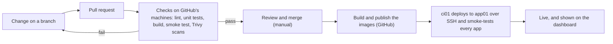

# homelab-lite

A small DevOps lab that runs on a **laptop**: two Linux virtual machines (VMs) and a free GitHub account. You make a
change, open a pull request, and watch it get tested, scanned, built and deployed automatically, with a dashboard
showing every part of the lab live.

It keeps the DevOps basics and leaves out everything a learner doesn't need yet.

## Where to start

1. **[docs/SETUP.md](docs/SETUP.md)**: build the lab, step by step, with VirtualBox. Written for complete beginners:
   every step says what to do, why, and how to check it worked.
2. **[docs/LAPTOP.md](docs/LAPTOP.md)**: change the code from your own laptop with VS Code and Git, and follow your
   change all the way to the live app. With screenshots.

## What you'll learn

| DevOps basic | What it means | Where you'll see it |
|---|---|---|
| **Version control and code review** | Every change is tracked, and goes through a pull request that's checked before it's merged | A protected `main` branch: no direct pushes |
| **Continuous integration (CI)** | Every change is tested automatically, on a clean machine | [`pr-checks.yml`](.github/workflows/pr-checks.yml): lint, unit tests, image build, smoke tests |
| **Security scanning** | Every change is checked for leaked secrets, unsafe settings and known vulnerabilities | [`security-scan.sh`](scripts/security-scan.sh): Trivy on the repo and every image |
| **Containers and a registry** | Apps are packaged as images, stored in a registry, and run the same way everywhere | `apps/*/Dockerfile`; images on GitHub's container registry, tagged by commit |
| **Continuous deployment (CD)** | Every merged change goes live by itself | [`deploy.yml`](.github/workflows/deploy.yml) + [`deploy.sh`](scripts/deploy.sh) |
| **Infrastructure as code** | Machines are set up from files, the same way every time | [`ansible/`](ansible/): both VMs are set up by playbooks |
| **Observability** | You can see what's running and whether it's healthy | The dashboard, container health checks, the smoke tests |

## How a change goes live



1. You change something on a **branch** (your own copy of the code) and open a **pull request** (PR).
2. **Checks** run on GitHub's machines: they look for mistakes, run the tests, build the images and scan them.
3. If they pass, the **review and merge** are done manually. That's the only manual step.
4. GitHub builds the images again and publishes them.
5. Your **runner** on ci01 picks up the deploy job, copies the settings to app01, starts the new versions, and
   checks each app answers.
6. The dashboard shows the new version running.

## The lab

| VM | RAM / CPUs | What it runs |
|---|---|---|
| **ci01** | 2 GB / 2 | The GitHub Actions **runner** (it only runs jobs after a merge), Ansible, and a heartbeat to app01 |
| **app01** | 2 GB / 2 | Docker + Compose, Caddy (the web front door, port 80), the apps, and a status collector |

A laptop with 8 GB of RAM can run it; 12 GB or more is comfortable [estimate]. Details:
[docs/SETUP.md, Part 1](docs/SETUP.md#part-1--what-you-need).

## The apps

| App | What it is | Address |
|---|---|---|
| **dashboard** | Every part of the lab and its state (up, down, running, busy, idle, stopped), each container's health, and links to the apps | `http://<app01-ip>/` |
| **example-data** | A web page showing a small table from `data.json`: the template for your own apps | `http://example-data.<app01-ip>.nip.io` |
| **news** | The top 5 headlines from a news feed (RSS/Atom), each linking to the full story | `http://news.<app01-ip>.nip.io` |

`<app01-ip>` is your app01's IP address, e.g. `192.168.0.112`. [nip.io](https://nip.io) turns a name like
`news.192.168.0.112.nip.io` back into that address, so you don't need to set up DNS.

## What's in this repo

```
ansible/              The list of your two VMs (inventory), the playbooks, and the small scripts they install
apps/                 dashboard, example-data, news: one folder per app
deploy/               compose.yml and Caddyfile: how app01 runs the apps
scripts/              What the pipelines actually do (the workflow files only call these)
.github/workflows/    pr-checks.yml (every pull request) and deploy.yml (after a merge)
docs/SETUP.md         The beginner guide: build the lab
docs/LAPTOP.md        Working on the code from your laptop (VS Code + Git)
AI-RULES.md           Rules for AI coding assistants working in this repo
```

## Ready for more?

[zulhardy-lab/homelab](https://github.com/zulhardy-lab/homelab) is the bigger version: three VMs, Kubernetes (k3s),
separate DEV and PRD environments with manual approvals, and a secrets vault (OpenBao).
