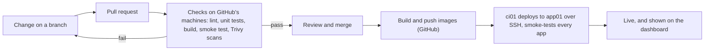

# homelab-lite

A two-VM DevOps lab that runs on a laptop. It keeps the DevOps basics (pull requests, automated tests, security
scans, container images, continuous deployment, infrastructure as code) and leaves out everything a learner
doesn't need yet.

**Start here: [docs/SETUP.md](docs/SETUP.md)**, a step-by-step guide written for beginners, with VirtualBox.



## The lab

| VM | RAM / CPUs | Runs |
|---|---|---|
| **ci01** | 2 GB / 2 | GitHub Actions runner (only after a merge), Ansible, a heartbeat to app01 |
| **app01** | 2 GB / 2 | Docker + Compose, Caddy (port 80), the apps, a status collector |

A laptop with 8 GB RAM can run it; 12 GB or more is comfortable [estimate]. Details: [docs/SETUP.md](docs/SETUP.md#part-1--what-you-need).

## The apps

| App | What it is | Address |
|---|---|---|
| **dashboard** | Every part of the lab and its state (up, down, running, busy, idle, stopped), each container's health, links to the apps | `http://<app01-ip>/` |
| **example-data** | A webpage serving a small table from `data.json`: the template for your own apps | `http://example-data.<app01-ip>.nip.io` |
| **news** | The top 5 headlines from a news feed (RSS/Atom), each linking to the full story | `http://news.<app01-ip>.nip.io` |

## DevOps basics, and where they are

| Basic | Where |
|---|---|
| Version control and code review | Protected `main`, every change through a pull request |
| Continuous integration | [`pr-checks.yml`](.github/workflows/pr-checks.yml): lint, unit tests, build, smoke tests |
| Security scanning | [`security-scan.sh`](scripts/security-scan.sh): Trivy on the repo and every image |
| Containers and a registry | `apps/*/Dockerfile`, images on GitHub's container registry, tagged by commit |
| Continuous deployment | [`deploy.yml`](.github/workflows/deploy.yml) + [`deploy.sh`](scripts/deploy.sh): merge, and it deploys |
| Infrastructure as code | [`ansible/`](ansible/): both VMs are set up from playbooks |
| Observability | The dashboard, container health checks, the smoke tests |

## Layout

```
ansible/              inventory (your two VMs), playbooks, and the small host scripts they install
apps/                 dashboard, example-data, news: one folder per app
deploy/               compose.yml and Caddyfile: how app01 runs the apps
scripts/              pipeline logic (the workflows only call these)
.github/workflows/    pr-checks.yml (every PR), deploy.yml (after merge)
docs/SETUP.md         the beginner guide
docs/LAPTOP.md        working on the code from your laptop (VS Code + Git)
AI-RULES.md           rules for AI coding agents working in this repo
```

## Ready for more?

[zulhardy-lab/homelab](https://github.com/zulhardy-lab/homelab) is the bigger version: three VMs, Kubernetes (k3s),
DEV and PRD environments with approvals, and a secrets vault (OpenBao).
