# Work on the code from your laptop

In [SETUP.md Part 9](SETUP.md#part-9--make-a-change) you changed a file in GitHub's web editor. That's fine for a
one-line fix, but real work happens on your own computer: you get a proper editor, you can run the tests before you
push, and you learn the Git commands every DevOps job expects.

This guide walks through the whole loop by hand, with **VS Code buttons** and with the **same steps as commands**,
so you understand what each button does.

> The screenshots come from the author's lab on Windows. Your account, org and repository names will be your own.
> Where a picture shows `zulhardy-lab/homelab-lite`, read it as `<your-org>/<your-repo>`.

## Contents

- [The big picture](#the-big-picture)
- [Part A — One-time setup](#part-a--one-time-setup)
- [Part B — Where things live](#part-b--where-things-live)
- [Part C — Make a change in VS Code](#part-c--make-a-change-in-vs-code)
- [Part D — Pull request, checks, merge](#part-d--pull-request-checks-merge)
- [Part E — Watch it deploy](#part-e--watch-it-deploy)
- [Part F — Clean up](#part-f--clean-up)
- [Part G — The same loop with commands](#part-g--the-same-loop-with-commands)
- [When things go wrong](#when-things-go-wrong)
- [Good habits](#good-habits)

---

## The big picture

You have **your copy** of the code on your laptop and **the shared copy** on GitHub. Every change travels from one
to the other in the same careful, checked way:

```text
laptop:  branch → edit → stage → commit ──push──▶ GitHub: pull request → checks ✅ → merge into main
                                                                                    │
                                     app01 (your app is live) ◀── ci01 runner ◀────┘ deploy
```

| Step | What it means |
|---|---|
| **Branch** | A copy of `main` you can change safely. `main` is what gets deployed, so you never edit it directly. |
| **Stage** | Choose which changed files go into the next save point. |
| **Commit** | A save point (snapshot) with a message saying *why*. Each commit gets an ID like `da8f88b`. |
| **Push / Publish** | Upload your branch and its commits to GitHub. Until now, everything was only on your laptop. |
| **Pull request (PR)** | "Here's my branch, please pull it into `main`." |
| **Checks** | Robots that test, lint and scan your change. `main` only accepts changes that passed. |
| **Merge** | Your commits join `main`. |
| **Deploy** | Because `main` changed, the pipeline builds new images and your runner puts them on app01. |

This loop is **CI/CD**: **C**ontinuous **I**ntegration (every change is tested before it joins `main`) and
**C**ontinuous **D**eployment (every change that joins `main` goes live by itself).

---

## Part A — One-time setup

### A1. Install the tools

| Tool | Why | Where |
|---|---|---|
| **Git** | Tracks changes and talks to GitHub | Windows: [Git for Windows](https://git-scm.com/download/win) (keep the defaults). macOS: `xcode-select --install`. Linux: `sudo apt install git` |
| **VS Code** | The editor | [code.visualstudio.com](https://code.visualstudio.com) |
| **Python 3** (optional) | Run the apps' tests on your laptop | [python.org](https://www.python.org/downloads/) |

Git for Windows includes **Git Bash** (a terminal where the commands in this guide work as written) and **Git
Credential Manager**, which signs you in to GitHub through your browser. You never type a password or token into the
terminal.

### A2. Tell Git who you are

Your name and email go into every commit, and this repository is **public**. Use GitHub's private **noreply**
address, not your real email:

1. 🌐 GitHub → your picture → **Settings** → **Emails**.
2. Tick **Keep my email addresses private** and **Block command line pushes that expose my email**.
3. Copy the address that looks like `12345678+your-username@users.noreply.github.com`.

💻 **In a terminal** (one line at a time):

```bash
git config --global user.name "Your Name"
git config --global user.email "12345678+your-username@users.noreply.github.com"
git config --global --list
```

✅ The last command shows `user.name=` and `user.email=` with **your** values, not the examples above.

### A3. Get a copy of the repository (clone)

```bash
cd ~
git clone https://github.com/<your-org>/<your-repo>.git
cd <your-repo>
code .
```

`code .` opens the folder in VS Code. If `code` isn't found, open VS Code and use **File → Open Folder…** instead.

✅ VS Code shows the repository's folders on the left (the **Explorer**), like this:

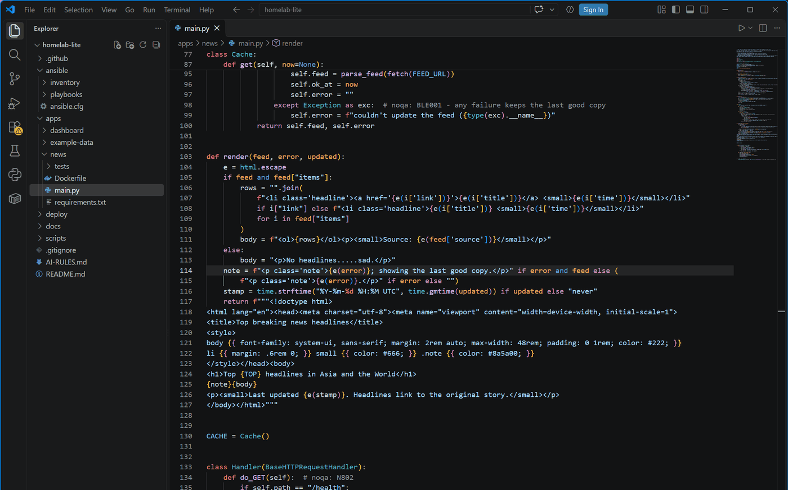

### A4. Open the terminal inside VS Code

**Terminal → New Terminal** (or **Ctrl + `**, the key left of 1). A panel opens at the bottom, already in your
repository folder. To get Git Bash, click the **˅** next to **+** on the right of that panel and pick **Git Bash**
(PowerShell also works for every `git` command):

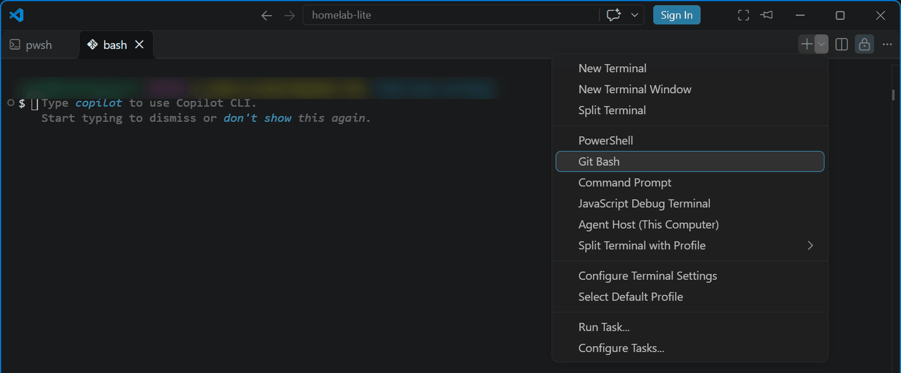

---

## Part B — Where things live

| You want to change… | File |
|---|---|
| What an app's page says or does | `apps/<app>/main.py` |
| An app's tests | `apps/<app>/tests/` |
| How an app's image is built | `apps/<app>/Dockerfile` |
| Which apps run, their settings (e.g. the news feed) | `deploy/compose.yml` |
| The web addresses (`*.nip.io` names) | `deploy/Caddyfile` |
| What the checks and the deploy do | `scripts/*.sh` |
| How the VMs are set up | `ansible/playbooks/` |

Example: the news page's heading is in `apps/news/main.py`, in the `render()` function, on the line with `<h1>`.
The browser tab's title is the `<title>` line just above it.

> Some words are checked by the tests (for example `Source:` and `class='headline'` in the news app). If you change
> those, update the matching test in the same branch, or the `apps (news)` check fails. That's the tests doing their
> job.

---

## Part C — Make a change in VS Code

### C1. Start from an up-to-date `main`

Look at the **bottom-left** of VS Code. It always shows the branch you're on.

1. Click the branch name → pick **main** (under "branches", not `origin/main`).
2. Click the **sync** icon (↻) next to it to download what's new on GitHub.

If you see arrows like `0↓ 1↑` next to the name, see [When things go wrong](#when-things-go-wrong).

### C2. Create a branch *before* you edit

Click the branch name at the bottom-left. A list opens at the **top centre** of the window (easy to miss). Choose
**+ Create new branch…**, type a name, press **Enter**:

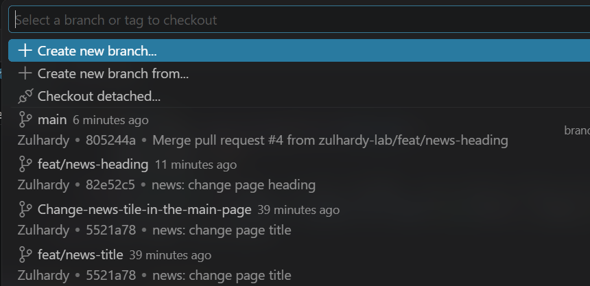

Name branches `feat/<short-name>` for new things, `fix/<short-name>` for fixes, `chore/<short-name>` for tidying, e.g.
`feat/news-heading`. (`Change-news-tile-in-the-main-page` in the picture is an example of a name *not* to use.)

✅ The bottom-left now shows your new branch name.

Other ways to do the same: **Ctrl+Shift+P** → **Git: Create Branch…**, or in Source Control **···** → **Branch** →
**Create Branch…**.

### C3. Edit and save

Open the file in the Explorer, change it, and **save with Ctrl+S**. A dot on the file's tab means it isn't saved yet.

### C4. Check what you changed

Open **Source Control**: the branch-shaped icon on the far left (third from the top), or **Ctrl+Shift+G**. Your
changed file is listed under **Changes** with an **M** (modified). Click it to see the old version (left, red) next to
your version (right, green):

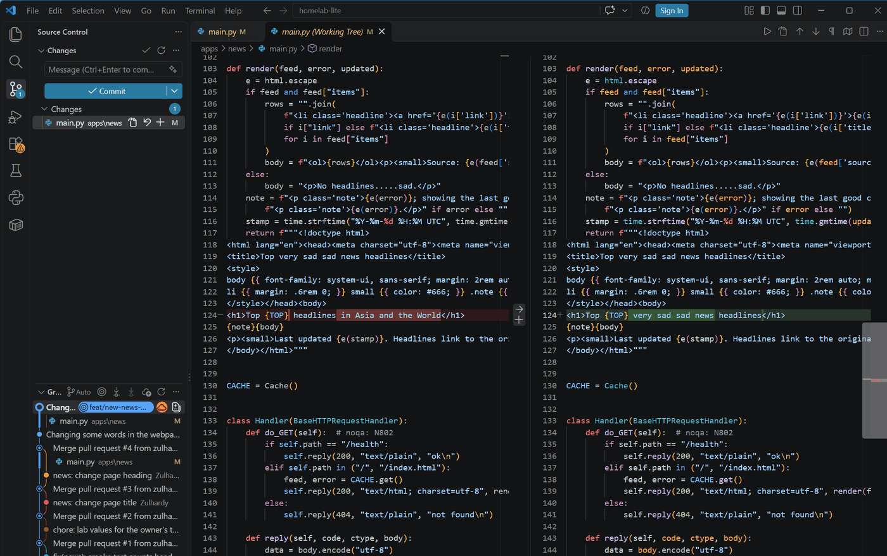

Hover over the file under **Changes** and three icons appear at the end of its line:

| Icon | Does | Command |
|---|---|---|
| 📄 Open File | Opens the file | |
| ↶ **Discard Changes** | **Throws your edit away.** Only click it if you mean it. | `git restore <file>` |
| **+** Stage Changes | Puts the file in the "ready to commit" pile | `git add <file>` |

If **Changes** is empty, your edit isn't saved.

### C5. Stage and commit

1. Click **+** next to the file. It moves up to **Staged Changes**.
2. Type a short message in the **Message** box saying *what and why*, e.g. `news: change page heading`.
3. Click **Commit**.

If you forgot to save, VS Code asks first. Choose **Save All & Commit Changes**; **Commit Changes** would commit the
older, saved version:

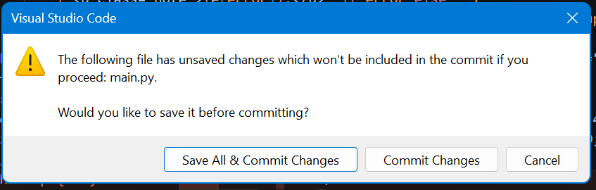

If you click **Commit** with an empty message box, VS Code opens a file called `COMMIT_EDITMSG` for the message. Type
it on line 1 (lines starting with `#` are ignored), then click the **Commit** button in that tab:

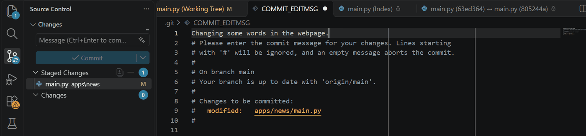

### C6. Publish the branch

So far everything is only on your laptop. Click **Publish Branch**:

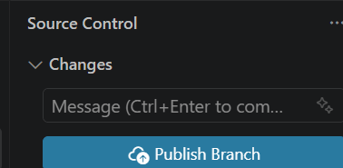

A branch that hasn't been published shows a **cloud with an arrow** at the bottom-left:

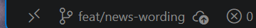

The first time, a window asks you to sign in to GitHub: choose **Sign in with your browser** and approve it there.

Committing more changes to the same branch later? Commit as before, then click **Sync Changes** (it replaces
**Publish Branch**). The PR updates by itself.

---

## Part D — Pull request, checks, merge

### D1. Open the pull request

🌐 Open your repository on GitHub. A yellow banner offers your new branch. Click **Compare & pull request**:

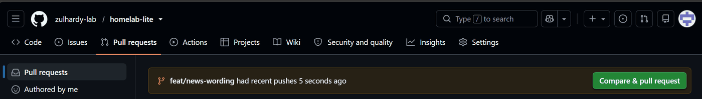

Check the top line says **base: main ← compare: your branch**. Give the PR a clear title, describe what changed and
why, and click **Create pull request**:

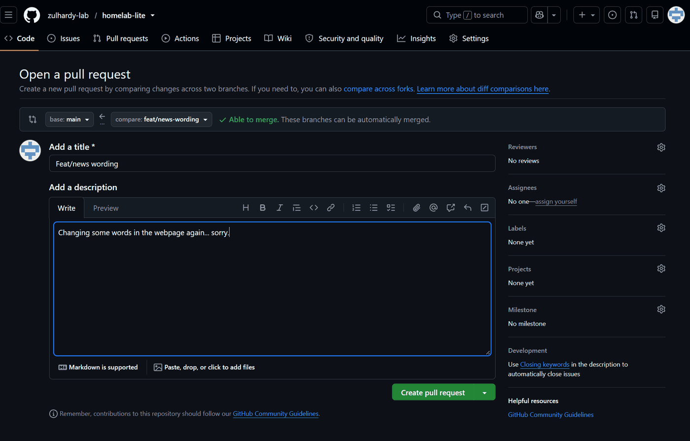

### D2. Wait for the checks

The checks start by themselves and run on GitHub's machines (never on your runner). **Merge pull request** stays grey
until they pass:

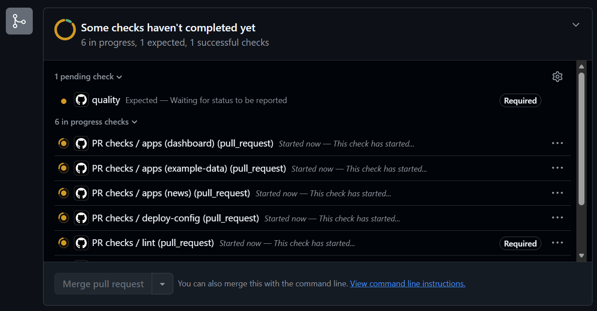

| Check | What it does |
|---|---|
| `lint` | Code tidiness and syntax: YAML, Ansible, shell scripts, Python |
| `repo-scan` | Looks for leaked secrets and unsafe settings in the whole repository |
| `deploy-config` | Checks `deploy/compose.yml` and the `Caddyfile` are valid, and scans them |
| `detect` | Works out which apps exist |
| `apps (<name>)` | For each app: unit tests, build the image, start it, smoke test, scan it |
| `quality` | Passes only if all the others passed. **Required**, with `lint` |

Click **Details** (or the **Checks** tab) to see a check's log. The **Actions** tab shows the same run as a picture,
with the order the jobs ran in:

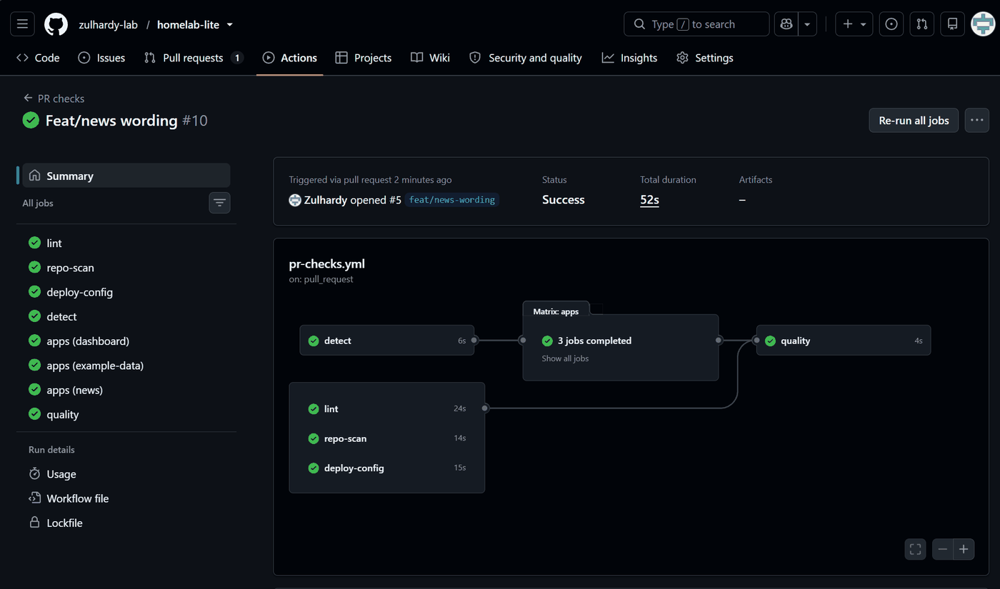

### D3. Merge

When everything is green, click **Merge pull request**, then **Confirm merge**:

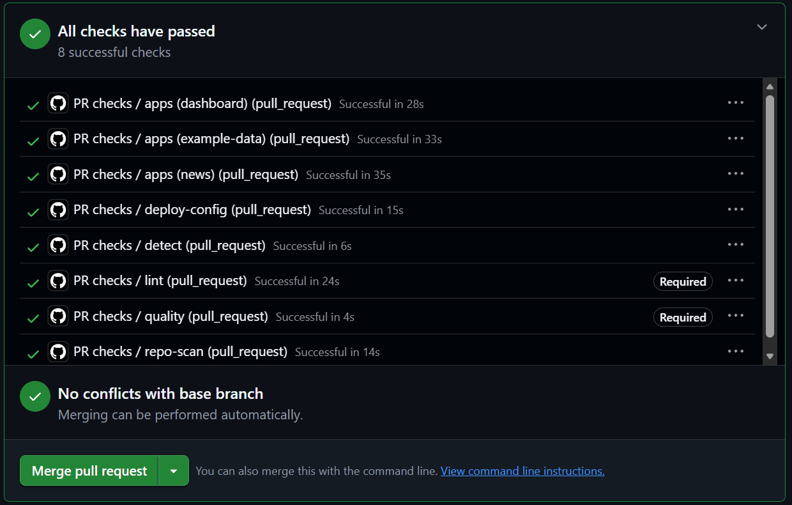

If a check fails, don't merge: read its log, fix the file on the same branch, commit and push again. The checks rerun.

---

## Part E — Watch it deploy

Merging changed `main`, so the **deploy** workflow starts. 🌐 **Actions** → **deploy**:

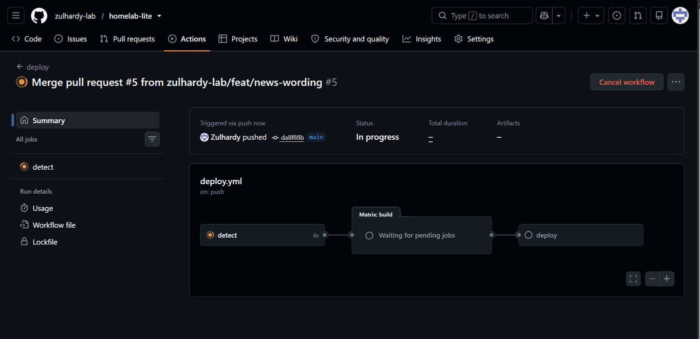

1. **detect** finds the apps.
2. **build** (one per app, on GitHub's machines) builds each image, tagged with the commit ID, and pushes it to
   GitHub's container registry.
3. **deploy** runs on **your runner on ci01**: it copies `deploy/` to app01, pulls the new images, restarts the
   containers, and smoke-tests every app.

Click **deploy** to watch its log:

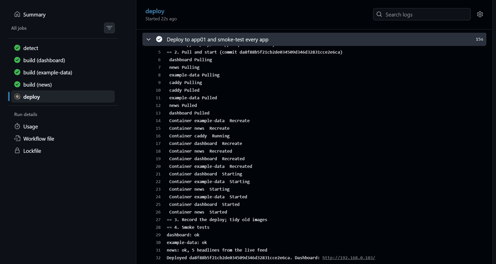

The dashboard (`http://<app01-ip>/`) updates every second, so you can watch it happen:

- The runner turns **busy** while the deploy runs, then back to **idle** ("online, waiting for a job").
- The line under the title shows your commit after **Last deploy**, and each app's image ends in that commit ID.
- **Last deploy on app01**, at the bottom, is app01's own log of the deploy: pulling the new images, then replacing
  the containers. It should end with `finished, exit code 0`.

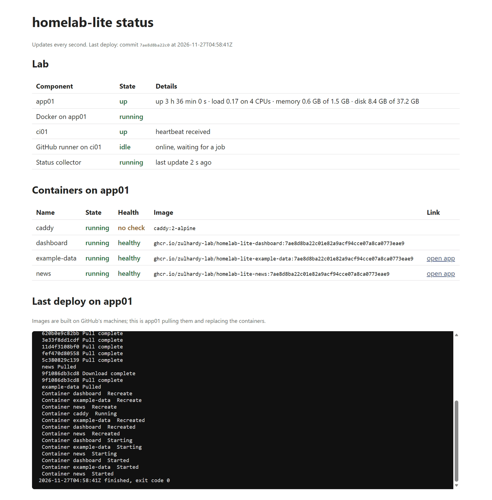

Open the app and see your change (press **Ctrl+F5** if the browser shows the old copy). In this example, the change
compared in [C4](#c4-check-what-you-changed) replaced the news page's heading.

**Before:**


**After:**


---

## Part F — Clean up

**Back on your laptop:** click the branch name at the bottom-left → **main**, then **sync** (↻), so your next change
starts from the latest `main`.

**Delete branches you've merged.** They've done their job, and old branches cause confusing PRs if you reuse them.

- On your laptop: **Ctrl+Shift+P** → **Git: Delete Branch…** → pick it. This doesn't touch GitHub or `main`.
- On GitHub: **Code** → **branches**. A branch with **Ahead 0** and a merged PR is safe to delete with 🗑 (GitHub
  offers **Restore** if you change your mind):

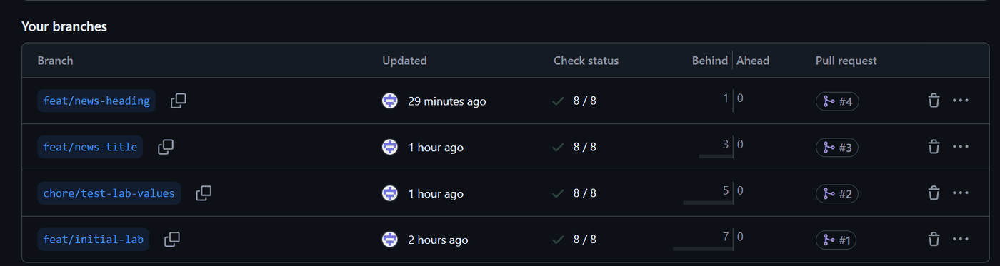

Better: 🌐 **Settings** → **General** → **Pull Requests** → tick **Automatically delete head branches**, and GitHub
deletes each branch when its PR is merged.

---

## Part G — The same loop with commands

Every button above runs a Git command underneath. Learn these: servers, pipelines, tutorials and job interviews all
use them, and error messages talk in their terms.

```bash
# start from the latest main
git switch main
git pull

# new branch for this change
git switch -c feat/news-heading

# ...edit and save in VS Code...

# what changed?
git status                 # which files
git diff                   # which lines

# optional: run the app's tests on your laptop
python -m pip install --require-hashes -r apps/news/requirements.txt
python -m unittest discover -s apps/news/tests -v

# save point
git add apps/news/main.py
git commit -m "news: change page heading"

# upload; Git prints a link to open the pull request
git push -u origin feat/news-heading

# after the PR is merged
git switch main
git pull
git branch -d feat/news-heading
```

The few worth knowing by heart: `git status`, `git switch`, `git pull`, `git add`, `git commit`, `git push`. Look the
rest up when you need them.

---

## When things go wrong

| You see | What it means | What to do |
|---|---|---|
| `GH013: Repository rule violations found for refs/heads/main` and `[remote rejected]` | You committed on `main` and tried to push it. The ruleset only lets changes into `main` through a PR that passed the checks. **Nothing changed on GitHub.** | Move your commit to a branch: bottom-left → **+ Create new branch…** (it starts from where you are, so it includes your commit) → **Publish Branch** → open the PR. After it's merged, switch to `main` and **sync**. |
| Bottom-left shows `main 0↓ 1↑` | `↑`: commits on your laptop that aren't on GitHub. `↓`: commits on GitHub you don't have yet. | `↓` only: click sync. `↑` on `main`: you committed on `main`, see the row above. |
| A check is red | Something in your change broke a test, the lint or a scan. | Open the check's log, fix the file on the same branch, commit, push. |
| `Import "defusedxml…" could not be resolved` in **Problems** (Ctrl+Shift+M) | VS Code can't find the library on your laptop. It's installed in the image and on the check machines. | Harmless. To remove it: `python -m pip install --require-hashes -r apps/news/requirements.txt` |
| `LF will be replaced by CRLF` | Windows and Linux end lines differently. Git converts them for you. | Harmless. If `git diff` shows *every* line changed, ask for help before committing. |
| The page doesn't show your change after the deploy | Usually the browser showing an old copy, or you changed `<title>` (the tab text) rather than `<h1>` (the heading). | **Ctrl+F5**. Check the dashboard's **Last deploy** shows your commit. |
| Changes are missing from your PR | They weren't saved, or weren't staged. | Save, stage, commit, push again on the same branch. |

The rejected push looks like this:

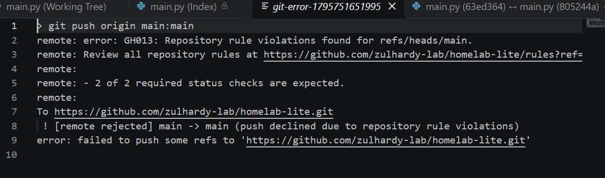

And the arrows on `main` after a commit that never reached GitHub:

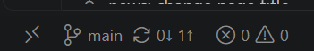

---

## Good habits

- **Look at the bottom-left before you edit.** If it says `main`, create a branch first.
- **One branch per change**, always started from an up-to-date `main`. Never reuse a merged branch.
- **Read `git diff` (or the side-by-side view) before every commit.**
- **Write commit messages that say why**, e.g. `news: heading names Asia`, not `update`.
- **Never commit `.env` files, keys or passwords.** `.gitignore` and the scans catch most of them, but don't rely on
  that.
- **Let the checks judge your change**, not the warnings on your laptop.
