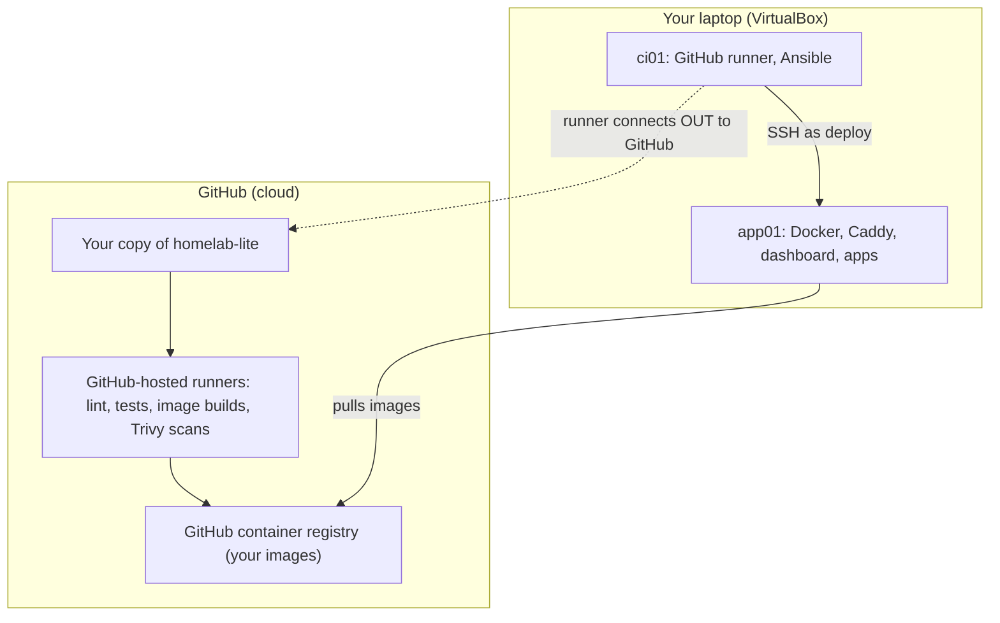

# Set up homelab-lite: a step-by-step guide

This guide takes you from **nothing** to a working DevOps lab on your laptop: two Linux virtual machines (VMs), a
CI/CD pipeline that tests, scans and builds your apps on GitHub, and deploys them automatically after you merge a
pull request. A dashboard shows the state of everything.

Every step says **what to do**, **why**, and **how to check it worked**. Take it one part at a time. If something
doesn't match what you see, check the [Troubleshooting](#troubleshooting) table before carrying on.

> **Time needed** [estimate]: about 2–3 hours the first time. You can stop after any part.

## Contents

- [What you'll build](#what-youll-build)
- [How to read this guide](#how-to-read-this-guide)
- [Words you'll see](#words-youll-see)
- [Part 1 — What you need](#part-1--what-you-need)
- [Part 2 — Plan your network](#part-2--plan-your-network)
- [Part 3 — Create the two VMs in VirtualBox](#part-3--create-the-two-vms-in-virtualbox)
- [Part 4 — Set up GitHub](#part-4--set-up-github)
- [Part 5 — Prepare ci01](#part-5--prepare-ci01)
- [Part 6 — Run the playbooks](#part-6--run-the-playbooks)
- [Part 7 — Install the runner](#part-7--install-the-runner)
- [Part 8 — First deploy](#part-8--first-deploy)
- [Part 9 — Make a change](#part-9--make-a-change)
- [Part 10 — Add your own app](#part-10--add-your-own-app)
- [Part 11 — Test the safety controls](#part-11--test-the-safety-controls)
- [The news app](#the-news-app)
- [Using an AI coding tool](#using-an-ai-coding-tool)
- [Security: what's protected, and the trade-offs](#security-whats-protected-and-the-trade-offs)
- [Troubleshooting](#troubleshooting)

## What you'll build



- **ci01** is the control machine: you type almost every command there, and it runs GitHub's runner.
- **app01** is the server: it runs your apps in Docker containers, behind a reverse proxy (Caddy).
- After setup, the only things you do by hand are **reviewing and merging pull requests**. Everything else (tests,
  scans, image builds, the deploy) runs automatically.

## How to read this guide

| You see | It means |
|---|---|
| 🌐 **In your browser** | Do this on github.com, on your own PC |
| 💻 **On your PC** | Do this on your own computer (the one running VirtualBox) |
| 🖥️ **On ci01** | Type this in a terminal on the ci01 VM (Part 5 shows how to open one) |
| `<your-user>` | Replace with **your own** value, without the `< >`. E.g. `<your-user>` → `alex` |
| ✅ **Check** | What you should see if it worked. Don't skip these |
| ⚠️ | Something to be careful with |

Code blocks are meant to be **copied and pasted**. In most terminals, paste is `Ctrl+Shift+V` (Linux) or a
right-click (Windows Terminal).

## Words you'll see

| Word | Meaning |
|---|---|
| **VM** (virtual machine) | A computer simulated inside your real one. You'll make two |
| **VirtualBox** | The free program that runs the VMs (a "hypervisor") |
| **SSH** | A secure way to open a terminal on another machine over the network |
| **Ansible** | A tool that sets up machines from a description (a "playbook"), the same way every time |
| **Docker / container** | Packages an app with everything it needs, so it runs the same everywhere |
| **Caddy** | A reverse proxy: it receives web requests on app01 and passes each one to the right app |
| **Runner** | A program on ci01 that runs GitHub Actions jobs inside your home network |
| **Pull request (PR)** | A proposed change. Checks run on it, then a person reviews and merges it |
| **Repo** (repository) | A project folder on GitHub, with its full history |

---

## Part 1 — What you need

### 1.1 Hardware

Your laptop runs both VMs **at the same time**, so it needs memory for both **plus** for itself.

| | ci01 | app01 | Your laptop |
|---|---|---|---|
| RAM, minimum | 1.5 GB | 1.5 GB | 8 GB (close other programs while the VMs run) |
| RAM, recommended | 2 GB | 2 GB | 12 GB or more |
| CPUs | 2 | 2 | 4 threads, virtualization turned on in the BIOS/UEFI |
| Disk | 15 GB min, 20 GB recommended | 15 GB min, 20 GB recommended | 40 GB free, SSD preferred |

These are estimates for this lab [estimate]: there's no Kubernetes, ci01 mostly waits for jobs, and app01 runs
Docker, Caddy and three small Python apps.

If VirtualBox says virtualization isn't available, it's usually switched off in your laptop's BIOS/UEFI settings
(look for "Intel Virtualization Technology", "VT-x", "SVM" or "AMD-V").

### 1.2 Software and accounts

- [ ] **VirtualBox** from [virtualbox.org](https://www.virtualbox.org/wiki/Downloads).
- [ ] **Ubuntu Server 26.04 LTS** installer image (ISO) from [ubuntu.com/download/server](https://ubuntu.com/download/server).
      ⚠️ It must be **26.04**: the setup checks this and stops on any other version.
- [ ] **A GitHub account** (free). An organization of your own works too.
- [ ] **A password manager** (e.g. Bitwarden, KeePassXC). You'll keep your VM password there.
- [ ] **Your home network**, not a school, office, hotel or phone-hotspot network. [Inference] Those often don't let
      VMs get their own addresses.

## Part 2 — Plan your network

**Why:** the machines talk to each other by IP address, so each one needs a **fixed** address that never changes.
To choose those addresses, you first need to know how your home network is numbered.

### 2.1 Find your home network details

💻 **On your PC**, connected to your home network (Wi-Fi or cable), find four things:

| What | What it is |
|---|---|
| **IPv4 address** | Your PC's own address on the network, e.g. `192.168.0.50` |
| **Subnet mask** | Which part of the address is "the network". Almost always `255.255.255.0` at home |
| **Default gateway** | Your router's address, e.g. `192.168.0.1` |
| **DNS servers** | Who turns names like github.com into addresses. Often the router itself |

<details open>
<summary><b>Windows</b></summary>

Open **Windows Terminal** or **PowerShell** (Start → type "terminal") and run:

```powershell
ipconfig /all
```

Scroll to the adapter you're actually connected through: **"Wireless LAN adapter Wi-Fi"** for Wi-Fi or
**"Ethernet adapter Ethernet"** for a cable. It's the one that **has a Default Gateway**. Ignore adapters named
`vEthernet`, `VirtualBox`, `VMware` or `Bluetooth`. Example:

```
Wireless LAN adapter Wi-Fi:
   IPv4 Address. . . . . . . . . . . : 192.168.0.50(Preferred)
   Subnet Mask . . . . . . . . . . . : 255.255.255.0
   Default Gateway . . . . . . . . . : 192.168.0.1
   DNS Servers . . . . . . . . . . . : 192.168.0.1
```
</details>

<details>
<summary><b>macOS</b></summary>

**System Settings → Wi-Fi** (or **Network → Ethernet**) → **Details…** next to your network:
- **TCP/IP** tab: IP address, Subnet mask, Router (= default gateway)
- **DNS** tab: DNS servers
</details>

<details>
<summary><b>Linux</b></summary>

```bash
ip -4 addr        # look for "inet 192.168.0.50/24" on your Wi-Fi or Ethernet interface (/24 = 255.255.255.0)
ip route          # "default via 192.168.0.1" = the default gateway
resolvectl status | grep 'DNS Servers'
```
</details>

Now turn them into the values you'll type into the Ubuntu installer (Part 3.3). Fill in the last column:

| Installer field | How to work it out | Example | Yours |
|---|---|---|---|
| **Subnet** | Your PC's address with the last number replaced by `0`, then `/24` (when the mask is `255.255.255.0`) | `192.168.0.0/24` | `____________` |
| **Gateway** | The default gateway, as is | `192.168.0.1` | `____________` |
| **Name servers** | The DNS server(s). If it shows something odd (e.g. starting with `fe80`), use the gateway | `192.168.0.1` | `____________` |

> ⚠️ If your subnet mask is **not** `255.255.255.0` (e.g. `255.255.254.0`), stop and ask for help: the `/24` part and
> the address choices below would be different.

### 2.2 Pick two addresses

Pick two free addresses in the same network. They must have the **same first three numbers** as your PC
(e.g. `192.168.0.x`). The examples in this guide:

| VM | Example address | Yours |
|---|---|---|
| ci01 | 192.168.0.111 | `____________` |
| app01 | 192.168.0.112 | `____________` |

- The last number must be between 2 and 254, and not your PC's or the router's.
- Pick numbers **outside your router's automatic (DHCP) range**, so the router never gives them to another device.
  To see the range, open the gateway address in your browser (e.g. `http://192.168.0.1`), log in (often printed on a
  sticker on the router), and look for **DHCP** settings ("start address" / "address pool"). If you can't check,
  numbers around 100–120 are often outside it [Inference], but test first.
- 💻 Test each address is free: `ping 192.168.0.111` should **fail** ("Request timed out" / "Destination host
  unreachable"). If something replies, that address is taken: pick another.
- Also choose **one username** you'll use on both VMs (e.g. `alex`). In this guide it's `<your-user>`.

Write your values down; you'll use them many times.

## Part 3 — Create the two VMs in VirtualBox

**Why:** each VM is a separate "computer" with its own job: ci01 controls, app01 serves.

### 3.1 Create each VM

In VirtualBox, click **New** and create two VMs, **ci01** and **app01**, with the same settings:

1. **Name and operating system**: name `ci01` (then `app01`); ISO image: the Ubuntu Server 26.04 ISO.
   If it offers **Unattended Installation** ("Skip Unattended Installation" box), **tick Skip**: you need to set the
   network by hand during the install.
2. **Hardware**: memory **2048 MB** (1536 MB at the very least); processors **2**.
3. **Hard disk**: **20 GB** (15 GB at the least), "Pre-allocate Full Size" **unticked**, so the file only grows
   as needed.
4. **Finish**, then open the VM's **Settings → Network → Adapter 1**:
   - **Attached to: Bridged Adapter**
   - **Name**: your laptop's real network card (the Wi-Fi one if you're on Wi-Fi).

   ⚠️ **NAT won't work**: with NAT, the VMs can't reach each other at their own addresses, and you can't SSH in.

Bridging over Wi-Fi works on most laptops but not all. If the VMs get no network in 3.3, try a network cable, or ask
for help.

<details>
<summary><b>Not using VirtualBox?</b> Hyper-V, Proxmox, VMware</summary>

The same rules apply everywhere: Ubuntu Server 26.04, 2 GB fixed memory, 2 CPUs, a bridged network.

- **Hyper-V**: Virtual Switch Manager → **External** switch on your real network card; New VM → **Generation 2**,
  **untick Dynamic Memory**; Settings → Security → Secure Boot template **Microsoft UEFI Certificate Authority**
  (Ubuntu won't boot with the Windows template).
- **Proxmox**: bridge **vmbr0**; in the Memory tab tick Advanced and **untick Ballooning Device**.
- **VMware Workstation / Player / Fusion**: network adapter **Bridged**; skip any "easy install".
</details>

### 3.3 Install Ubuntu on both VMs

Start the VM and go through the Ubuntu Server installer. Mostly accept the defaults, except:

1. **Network configuration**: choose your network interface → **Edit IPv4** → **Manual**, then type the values you
   wrote down in Part 2:

   | Field | Where it comes from | Example |
   |---|---|---|
   | Subnet | Part 2.1 | `192.168.0.0/24` |
   | Address | **this** VM's address, Part 2.2 | `192.168.0.111` for ci01 |
   | Gateway | Part 2.1 | `192.168.0.1` |
   | Name servers | Part 2.1 | `192.168.0.1` |
   | Search domains | leave empty | |

   Don't know these yet? Go back to [Part 2.1](#21-find-your-home-network-details): it shows how to find them on your
   PC.

2. **Profile**: your name; **server name** = `ci01` or `app01`; username = `<your-user>` (the same on both); a strong
   password. Using the **same password** on both keeps later steps to one password prompt.
3. **SSH**: tick **Install OpenSSH server**. Leave "import SSH key" off.
4. **Featured server snaps**: select nothing. (Docker comes later, from Ubuntu's own packages, and only on app01.)
5. When it says **Reboot now**, reboot. Remove the ISO if the VM boots into the installer again.

Repeat for the second VM.

✅ **Check** (💻 on your PC, in a terminal such as Windows Terminal or PowerShell):

```bash
ping 192.168.0.111      # use YOUR addresses; both should reply
ping 192.168.0.112
ssh <your-user>@192.168.0.111     # ci01: answer "yes" to the fingerprint question, then your password
```

You should land at a prompt like `<your-user>@ci01:~$`. Type `exit` to leave.

---

## Part 4 — Set up GitHub

Everything in this part is 🌐 **in your browser**.

### 4.1 Copy the repo

Open [github.com/zulhardy-lab/homelab-lite](https://github.com/zulhardy-lab/homelab-lite) → green **Use this
template** → **Create a new repository**:
- **Owner**: your own account, or your own organization (either works).
- **Name**: `homelab-lite`. **Public**. Then **Create repository**.

> Why public: GitHub's hosted runners are free for public repos. Why a template copy and not a fork: a fork's pull
> requests point at the original repo by default; a template copy is fully yours.

### 4.2 Put in your own values

**Why:** the copy contains example values. Change them **before** running anything. Open each file on GitHub →
pencil icon (**Edit**) → change it → **Commit changes…** → **Commit directly to the `main` branch** (only during
setup; from 4.3 on, every change goes through a pull request).

| File | Change |
|---|---|
| `ansible/inventory/hosts.ini` | On the `app01` line: `ansible_host=` → app01's address (Part 2.2); `ansible_user=CHANGE-ME` → `<your-user>` |
| `ansible/inventory/group_vars/all.yml` | `runner_repo_url` → `https://github.com/<your-account-or-org>/homelab-lite` |

That's all: image names come from your repo's name, and app01's address is only set in `hosts.ini`.

> Each commit may start a run in the **Actions** tab. A `deploy` run that stays **Queued** (no runner yet) is expected
> now: open it and click **Cancel workflow**.

### 4.3 Protect `main`

**Why:** from now on, nothing reaches `main` without a pull request and passing checks.

**Settings → Rules → Rulesets → New ruleset → New branch ruleset**:
- Name `protect-main`, Enforcement status **Active**; Target branches → **Add target** → **Include default branch**.
- ✅ **Restrict deletions**, ✅ **Block force pushes**.
- ✅ **Require a pull request before merging**, Required approvals **0** (GitHub doesn't count approvals from a PR's
  own author, so with 1 you'd lock yourself out; the PR itself is still required).
- ✅ **Require status checks to pass** → **Add checks** → `lint` and `quality`. If they aren't listed yet, open any
  small test PR first so they run once, then come back.
- **Create**.

### 4.4 Actions and security settings

**Settings → Actions → General**:
- **Approval for running fork pull request workflows from contributors** → **Require approval for all external
  contributors** → **Save**. Strangers' PRs can't run anything until you approve them.
- **Actions permissions** → ✅ **Require actions to be pinned to a full-length commit SHA** → **Save**.

**Settings → Advanced Security** (or **Code security**): enable **Secret Protection / secret scanning** and **Push
protection**. GitHub then blocks pushes that contain known kinds of secrets.

---

## Part 5 — Prepare ci01

### 5.1 Open a terminal on ci01

💻 On your PC: `ssh <your-user>@<ci01-address>`. Use this instead of the VirtualBox window: copy and paste work
properly. Everything marked 🖥️ from here on is typed there.

### 5.2 Install the tools

🖥️ **On ci01:**

```bash
sudo apt update
sudo apt install -y ansible git
```

`sudo` asks for your password. Nothing shows while you type it; that's normal.

### 5.3 Let ci01 log in to app01 without a password

**Why:** Ansible on ci01 sets up app01 over SSH. A key is safer and smoother than typing passwords.

🖥️ **On ci01** (use app01's address):

```bash
ssh-keygen -t ed25519 -C "ci01-admin"
# Press Enter for the default file, then type a passphrase (store it in your password manager).

ssh-copy-id <your-user>@192.168.0.112     # app01: answer "yes", then app01's password (the last time you'll need it)

eval "$(ssh-agent -s)"
ssh-add                                    # type the key's passphrase once
```

⚠️ The **ssh-agent** (the helper that remembers your unlocked key) only lasts for this terminal session: run the
last two lines again whenever you log in to ci01 to run Ansible.

✅ **Check:** `ssh <your-user>@192.168.0.112 hostname` prints `app01` with no questions asked.

### 5.4 Get your repo onto ci01

🖥️ **On ci01:**

```bash
git clone https://github.com/<your-account-or-org>/homelab-lite.git ~/homelab-lite
cd ~/homelab-lite && git log --oneline -3      # your commits from Part 4.2 are at the top
```

---

## Part 6 — Run the playbooks

**Why:** each playbook sets up one piece, the same way every time. Run them in this order.

🖥️ **On ci01:**

```bash
cd ~/homelab-lite/ansible
ansible all -m ping -K
```

`-K` asks for your **sudo password**. ✅ Both `ci01` and `app01` answer `SUCCESS` with `"ping": "pong"`.

Then, one at a time (each ends with a `PLAY RECAP`; every machine must show `failed=0`):

```bash
ansible-playbook playbooks/base.yml -K            # OS check, hostnames, a few tools
ansible-playbook playbooks/docker.yml -K          # Docker on app01 only
ansible-playbook playbooks/deploy-access.yml -K   # 'deploy' user on app01; ci01's runner user may log in as it
ansible-playbook playbooks/status.yml -K          # status collector on app01, every second
ansible-playbook playbooks/heartbeat.yml -K       # ci01's heartbeat to app01, every 30 s
```

| Playbook | What it does |
|---|---|
| `base.yml` | Stops if a VM isn't Ubuntu 26.04; sets the hostnames; installs Python, curl, SSH client |
| `docker.yml` | Installs Docker and Docker Compose on **app01** from Ubuntu's own packages. ci01 never gets Docker |
| `deploy-access.yml` | Creates the `deploy` user on app01 (it runs the containers) and gives ci01's runner user a key that can log in as `deploy` |
| `status.yml` | Every second, writes app01's state, Docker's state and the containers' state to a file the dashboard reads (a service that keeps running, not a timer) |
| `heartbeat.yml` | Every 30 seconds, ci01 tells app01 it's up and what the runner is doing, with a key that can only save that one message |

✅ **Check** (after about a minute):

```bash
ssh <your-user>@192.168.0.112 'docker --version; ls /srv/homelab-lite/status'
# Docker version ..., and the files ci01.json and status.json
```

---

## Part 7 — Install the runner

**Why:** the runner runs the deploy job inside your home network. It connects **out** to GitHub, so nothing on your
network is opened to the internet.

1. 🌐 Your repo → **Settings → Actions → Runners → New self-hosted runner** → **Linux**, **x64**.
2. In the **Configure** section, find `./config.sh --url https://github.com/<you>/homelab-lite --token XXXXXXXX`.
   Copy only the token. It expires quickly, so go straight on.
3. 🖥️ **On ci01:**

   ```bash
   cd ~/homelab-lite/ansible
   ansible-playbook playbooks/runner.yml -K
   ```

   It asks for your sudo password, then the token (hidden while you paste).

✅ **Check:** 🌐 the Runners page shows `ci01` as **Idle**, with labels `self-hosted`, `homelab-lite`, `ci01`.

---

## Part 8 — First deploy

1. 🌐 Your repo → **Actions** → **deploy** → **Run workflow** → branch `main` → **Run workflow**.
2. Watch it: `build` runs three times (one per app) on GitHub's machines, then `deploy` runs on ci01.

The first time, your three images are new on GitHub's container registry and may be **private** [Unverified]. app01
can't pull private images. If the `deploy` job fails with `unauthorized` or `denied` while pulling:
- 🌐 Your account or organization page → **Packages** → open `homelab-lite-dashboard` → **Package settings** →
  **Change visibility** → **Public**. Do the same for `homelab-lite-example-data` and `homelab-lite-news`.
- Then open the failed run → **Re-run failed jobs**.

✅ **Check:** 💻 open `http://<app01-address>/` in your browser. The dashboard shows:
- app01 **up**, Docker **running**, ci01 **up**, GitHub runner **idle** (or **busy** while a job runs), status
  collector **running**;
- the containers `caddy`, `dashboard`, `example-data` and `news`, all **running**, with links to the two apps.

---

## Part 9 — Make a change

This is the moment the whole lab exists for: a change goes from your idea to a running app, with tests on the way.

1. 🌐 Open `apps/example-data/data.json` → pencil → change something small (e.g. the title) → **Commit changes…** →
   **Create a new branch** → **Propose changes** → **Create pull request**.
2. Watch the checks run on the PR: `lint`, `repo-scan`, `deploy-config`, one `apps` job per app, then `quality`.
   They run on GitHub's machines; your runner isn't involved.
3. When they're green, **Merge pull request**.
4. The `deploy` workflow starts. On the dashboard, the runner turns **busy**, then back to **idle**, and "Last
   deploy" shows the new commit.
5. Open the example-data link from the dashboard: your change is live.

👉 **Next, do the same from your own laptop** with VS Code and Git, the way real projects work:
[LAPTOP.md](LAPTOP.md).

---

## Part 10 — Add your own app

Most apps here are small webpages that serve some data. Copy the template:

1. Copy the folder `apps/example-data/` to `apps/<your-app>/` (lowercase letters, digits and `-`).
2. Change its `data.json` (or its `main.py`). Keep `/health` and the tests working; add tests for what you change.
3. In `deploy/compose.yml`, copy the `example-data` service, rename it to `<your-app>` (service name,
   `container_name`, the image's last part), and set `homelab-lite.link: <your-app>`.
4. In `deploy/Caddyfile`, copy the `example-data` block and change both names to `<your-app>`.
5. Open one pull request with all of it. After the merge it's deployed and appears on the dashboard, at
   `http://<your-app>.<app01-address>.nip.io`.

The first deploy of a new app creates a new package on GitHub's registry: make it public as in Part 8.

---

## Part 11 — Test the safety controls

- **Direct pushes are blocked**: 🌐 open any file → pencil → **Commit changes…**: committing directly to `main` is
  blocked. Cancel.
- **Pull requests never run on your runner**: in a PR's checks, every job ran on a GitHub-hosted machine.
- **Emergency stop**: if a pipeline ever does something you don't want, stop the runner. Try it once:

  🖥️ **On ci01:**

  ```bash
  systemctl list-units 'actions.runner.*'      # note the full service name
  sudo systemctl stop 'actions.runner.*'       # STOP
  ```

  ✅ Within a minute the dashboard shows the GitHub runner **stopped**, and 🌐 the Runners page shows it **Offline**.
  Start it again with the **full** name (a pattern works for stop, not for start):

  ```bash
  sudo systemctl start <the full name you noted>
  ```

🎉 **Your lab is ready.** From now on: change things through pull requests, review, merge.

---

## The news app

`news` shows the top 5 headlines from one news feed, each linking to the full story. It reads the publisher's feed
(RSS or Atom); it doesn't scrape web pages, and it copies no article text.

**Change the feed**: in `deploy/compose.yml`, set `NEWS_FEED_URL` under the `news` service, in a pull request.

| Feed | Address | Terms (checked 2026-11-27) |
|---|---|---|
| CNA, Latest News (default) | `https://www.channelnewsasia.com/api/v1/rss-outbound-feed?_format=xml&category=6311` | Free RSS; link each headline to the full article, don't modify the feed, no ads |
| Malay Mail | `https://www.malaymail.com/feed/rss/` | "Copyright 2026 Malay Mail" |
| Inter Press Service | `https://www.ipsnews.net/feed/` | None stated in the feed |

Check a feed's terms before you switch to it. The app only runs on your own network.

**Tests**: the unit tests read `apps/news/tests/nasa-sample.xml`, a saved, trimmed copy of NASA's real news-release
feed (NASA content is generally not subject to US copyright; credited to NASA). They never go online. After each
deploy, the smoke test opens the live news page: it fails if the page doesn't load, and only **warns** if no headlines
came back (for example when the feed is down), so a publisher's outage doesn't block your deploys.

---

## Using an AI coding tool

The rules for AI coding agents working in this repo are in [`AI-RULES.md`](../AI-RULES.md). AI tools don't read that
file on their own: when you start, tell your tool to read `AI-RULES.md` and follow it.

---

## Security: what's protected, and the trade-offs

The lab keeps one firm line: **code that hasn't been reviewed and merged never runs on your machines.**

| Control | How |
|---|---|
| Every change is reviewed | `main` only changes through pull requests with passing checks (Part 4.3) |
| PR code stays on GitHub | PR checks run on GitHub's machines only; your runner only runs `deploy.yml`, after a merge |
| No stored secrets | Nothing secret in the repo or in GitHub; images are pushed with GitHub's short-lived per-run token |
| Small, separate keys | ci01's deploy key can only log in to app01 as `deploy`; the heartbeat key can only save one status file |
| No Docker socket in containers | The dashboard reads a status file instead; every app container is read-only, with no capabilities |
| Pinned versions | Actions by commit SHA, base images by digest, the runner and Trivy by checksum, Python packages by hash |
| Scans | Trivy checks the repo and every image for secrets, misconfigurations and fixable critical vulnerabilities |

| Accepted trade-off | Why it's OK for a learning lab |
|---|---|
| `deploy` on app01 is in the `docker` group, which is effectively root on app01 | app01 only runs the apps and holds no keys or passwords |
| The deploy key is long-lived | It only reaches app01, only as `deploy`; re-run `deploy-access.yml` after deleting `/home/gha-runner/.ssh/id_deploy*` on ci01 to replace it |
| A merge deploys straight away | There's one environment, and every change was reviewed in its PR |
| You run Ansible by hand | No pipeline has admin access to your VMs at all |

Never commit or share: SSH private keys, your passwords, runner tokens.

---

## Troubleshooting

| You see | Likely cause | What to do |
|---|---|---|
| VMs can't `ping` each other or your PC | Network is NAT, or a wrong address | **Bridged Adapter** (Part 3.1); check the address, subnet and gateway you typed in the installer |
| VirtualBox: "VT-x is not available" | Virtualization off in the BIOS/UEFI | Turn on Intel VT-x / AMD-V (SVM) in your laptop's BIOS/UEFI |
| `Enter passphrase for key` during Ansible | ssh-agent not loaded | `eval "$(ssh-agent -s)" && ssh-add` |
| `homelab-lite targets Ubuntu 26.04` | A VM runs another Ubuntu version | Reinstall it with 26.04 |
| `docker.yml`: package not found | [Unverified] package names on 26.04 | Report it; the names are in `ansible/playbooks/docker.yml` |
| Runner registration fails (output hidden) | Expired token, or `runner_repo_url` not changed | Fresh token (Part 7); check `runner_repo_url` in `group_vars/all.yml` |
| `deploy` stays **Queued** | Runner offline | Runners page shows ci01 **Idle**? If not: `sudo systemctl start <runner service>` on ci01 |
| `deploy` fails: `unauthorized` / `denied` pulling images | Packages are private | Make them public (Part 8) |
| `deploy` fails: `Permission denied (publickey)` | deploy-access.yml not run, or app01 rebuilt | Re-run `deploy-access.yml` |
| Dashboard: ci01 **down** | Heartbeat not arriving | On ci01: `systemctl status homelab-lite-heartbeat.service` |
| Dashboard: status collector **stopped** | Collector service not running | On app01: `systemctl status homelab-lite-status.service`, then `journalctl -u homelab-lite-status.service -n 20` |
| News page: "No headlines yet" | Feed down or blocked | Wait 15 minutes, or try another feed (The news app) |
| A PR check failed | Read its log: Actions → the run → the red job | Fix it in the same PR; the checks run again on every push |

Still stuck? Note **which Part and step**, the **exact command**, and the **last 20 lines** of output. ⚠️ Before
sharing output with anyone (or any AI tool), check it contains no keys, tokens or passwords.
